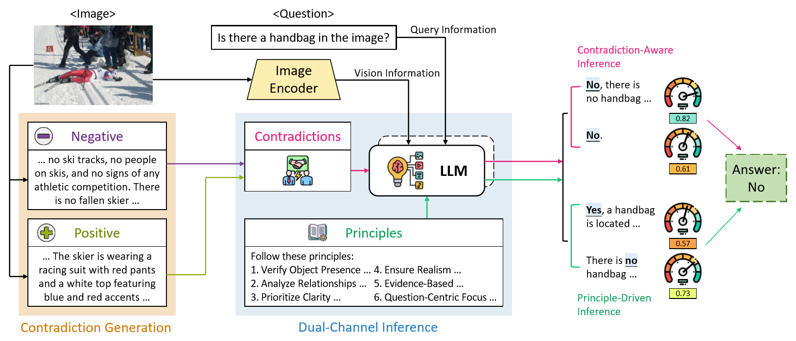
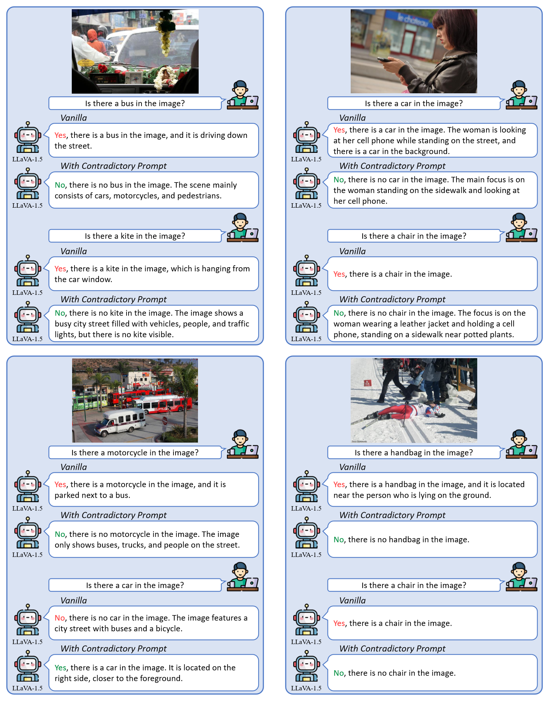

# CGVR: Contradiction-Guided Visual Reasoning for Mitigating Hallucinations in Multimodal Large Language Models

Official implementation of CGVR, published at AACL-IJCNLP 2026 by Haoran Ding, Wanqi Zhou, Lei Xing, Lujuan Dang, Kaizhong Zheng, and Badong Chen.

[ACL Anthology](https://aclanthology.org/2026.aacl-long.197/) · [Paper PDF](https://aclanthology.org/2026.aacl-long.197.pdf)

## Overview

CGVR is a training-free method for reducing hallucinations in multimodal large language models. It draws on the **Contradictory Prompting Effect (CPE)**, the observation that prompts which deliberately contradict an image can encourage a model to check its answer against visual evidence.

[](assets/figures/cgvr-framework.png)

*CGVR generates standard and deliberately negated captions, then combines confidence scores from contradiction-aware and principle-driven inference.* [Paper, Figure 3](https://aclanthology.org/2026.aacl-long.197.pdf#page=4)

The workflow below runs LLaVA-1.5-7B on the POPE object hallucination benchmark. The default configuration uses the **MS-COCO adversarial** split. [POPE benchmark](https://github.com/AoiDragon/POPE)

## Installation

Use an NVIDIA GPU with CUDA support. Python 3.10 is recommended for the bundled LLaVA implementation. [LLaVA installation guide](https://github.com/haotian-liu/LLaVA#install)

```bash
git clone https://github.com/dhr1698/CGVR.git
cd CGVR
conda create -n cgvr python=3.10 -y
conda activate cgvr
```

Install CUDA-enabled PyTorch and torchvision in the `cgvr` environment using the instructions for your platform, then install the remaining dependencies. [PyTorch installation guide](https://pytorch.org/get-started/locally/)

```bash
python -m pip install -r requirements.txt
python -c "import torch; print(torch.cuda.is_available())"
```

## Prepare the data

The repository includes POPE question and label files in [`benchmark/POPE/`](benchmark/POPE/) for MS-COCO, A-OKVQA, and GQA. Each dataset has `random`, `popular`, and `adversarial` splits. Download the corresponding images separately.

| POPE dataset | Annotation directory | Image source |
| --- | --- | --- |
| MS-COCO | `benchmark/POPE/coco/` | [COCO 2014 validation images](https://cocodataset.org/#download) |
| A-OKVQA | `benchmark/POPE/aokvqa/` | [COCO 2014 validation images](https://cocodataset.org/#download) |
| GQA | `benchmark/POPE/gqa/` | [GQA images](https://cs.stanford.edu/people/dorarad/gqa/download.html) |

For the default run, place the COCO validation JPEGs directly in `data/coco/`, so paths look like `data/coco/COCO_val2014_000000429109.jpg`.

## Run CGVR on POPE

Run the following commands from the repository root. The scripts use `benchmark/POPE/coco/coco_pope_adversarial.jsonl` by default and create their output directories as needed.

### 1. Image captioning

Generate the negative caption, which deliberately negates key image details, and the normal caption, which describes the image. Each script writes one caption record per question in the input file.

```bash
python caption/llava_caption_negative.py
python caption/llava_caption_normal.py
```

### 2. Reasoning

The contradiction-aware channel uses both captions and asks the model to cross-check them against the image. The principle-driven channel uses the image, question, and visual verification guidelines.

```bash
python reasoning/NF_llava_reasoning_contradiction.py
python reasoning/NF_llava_reasoning_guide.py
```

After the two stages, the default output directory contains the following files.

```text
output/coco_pope/
├── caption/
│   ├── coco_pope_adversarial_caption_llava_negative.jsonl
│   └── coco_pope_adversarial_caption_llava_normal.jsonl
└── NF/
    ├── NF_llava_contradiction_coco_adversarial_pope.jsonl
    └── NF_llava_guide_coco_adversarial_pope.jsonl
```

### 3. Evaluation

The evaluator combines the two scores for each candidate answer.

```bash
python eval/eval_pope.py
```

## Reported results

Table 1 of the paper reports the following LLaVA-1.5 results on the MS-COCO adversarial split of POPE. It also reports results for the other splits and for Qwen-VL. [Paper, Table 1](https://aclanthology.org/2026.aacl-long.197.pdf#page=6)

| Method | Accuracy | Precision | Recall | F1 Score |
| --- | ---: | ---: | ---: | ---: |
| Vanilla LLaVA-1.5 | 78.96% | 83.06% | 72.75% | 77.57% |
| LLaVA-1.5 + CGVR | 83.73% | 83.42% | 84.20% | 83.81% |

### Qualitative case studies

[](assets/figures/qualitative-results.png)

## Citation

If you find this code helpful for your research, please kindly cite the paper.

```bibtex
@inproceedings{ding2026cgvr,
  title     = {CGVR: Contradiction-Guided Visual Reasoning for Mitigating Hallucinations in Multimodal Large Language Models},
  author    = {Ding, Haoran and Zhou, Wanqi and Xing, Lei and Dang, Lujuan and Zheng, Kaizhong and Chen, Badong},
  booktitle = {Proceedings of the 15th International Joint Conference on Natural Language Processing and the 5th Conference of the Asia-Pacific Chapter of the Association for Computational Linguistics (Volume 1: Long Papers)},
  year      = {2026},
  address   = {Hengqin, China},
  publisher = {Association for Computational Linguistics},
  pages     = {4375--4387},
  doi       = {10.18653/2026.aacl-long.197},
  url       = {https://aclanthology.org/2026.aacl-long.197/}
}
```
